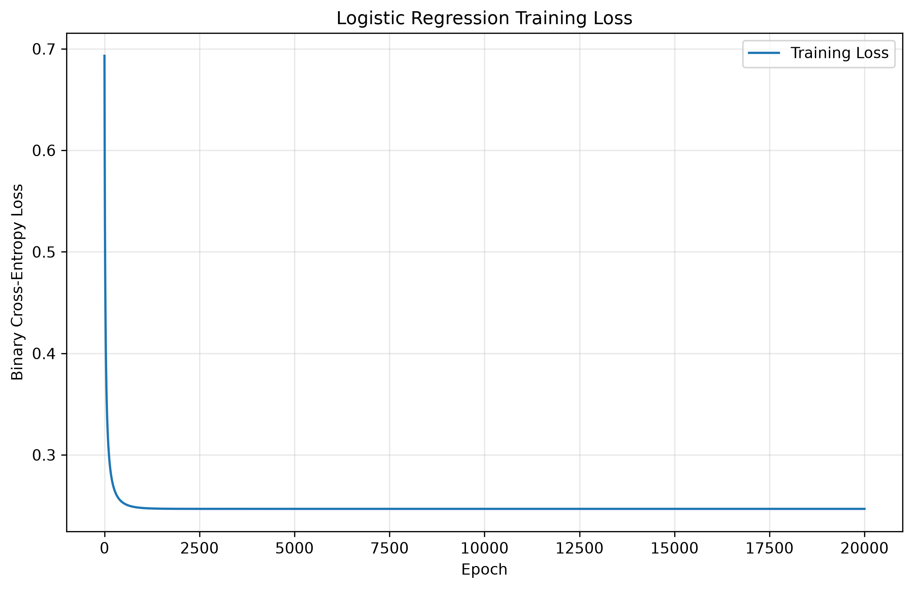

# Breast Mass Classification: Logistic Regression and Decision Thresholds

## Project Overview

This project explores how logistic regression works and how different classification thresholds affect prediction results.

The goal is to predict whether a breast mass sample is malignant or benign using two measurements from the Wisconsin Diagnostic Breast Cancer dataset.

The two features are:

- Mean radius
- Mean texture

The target classes are:

- **1 = Malignant**
- **0 = Benign**

A logistic regression model was built using NumPy and gradient descent. Its results were compared with scikit-learn Logistic Regression and a DummyClassifier baseline.

Seven classification thresholds were also tested to understand how they affect precision, recall, and F1 score.

**This project is for educational purposes only and is not intended for medical diagnosis.**

---

## Dataset

The Wisconsin Diagnostic Breast Cancer dataset is available through scikit-learn.

| Item | Value |
|---|---|
| Total samples | 569 |
| Benign samples (0) | 357 |
| Malignant samples (1) | 212 |
| Features | Mean radius, mean texture |
| Missing values | 0 |

The dataset contains measurements of cell nuclei from breast mass samples.

It is loaded directly from scikit-learn, so no separate CSV download is needed.

---

## Methods

Three models were used:

1. **NumPy Logistic Regression:** Built using full-batch gradient descent.
2. **Scikit-learn Logistic Regression:** Used to compare results with the NumPy implementation.
3. **DummyClassifier:** Used as a baseline for comparison.

### Data Preparation

The dataset was divided into three groups:

| Dataset | Records | Percentage |
|---|---:|---:|
| Training | 341 | Approximately 60% |
| Validation | 114 | Approximately 20% |
| Test | 114 | Approximately 20% |

Stratified sampling was used to keep similar class proportions across the three groups.

StandardScaler was fitted only on the training data and then applied to the validation and test data to prevent data leakage.

### Model Training

The NumPy model used the following settings:

| Setting | Value |
|---|---|
| Learning rate | 0.1 |
| Epochs | 20,000 |
| Initial coefficients | 0 |
| Training method | Full-batch gradient descent |
| Loss function | Binary cross-entropy |
| Regularization | None |
| Class weights | None |

The scikit-learn model was trained on the same standardized training data without regularization.

---

## Results

### Training Results

The NumPy model reduced training loss during gradient descent.

| Metric | Value |
|---|---:|
| Initial training loss | 0.693147 |
| Final training loss | 0.246834 |

The loss decreased quickly at the beginning and gradually became stable.



### Model Comparison

The NumPy and scikit-learn models produced almost identical coefficients.

| Coefficient | NumPy | Scikit-learn |
|---|---:|---:|
| Intercept | -0.727172 | -0.727172 |
| Mean radius | 3.656794 | 3.656794 |
| Mean texture | 1.009872 | 1.009872 |

The mean absolute difference between their validation probabilities was approximately 0.0000000001.

This shows that the NumPy implementation produced results very close to the scikit-learn reference model.

### Threshold Selection

Seven thresholds were tested on the validation data:

- 0.20
- 0.30
- 0.40
- 0.50
- 0.60
- 0.70
- 0.80

The threshold of **0.60** was selected because it had the highest validation F1 score of **0.831169**.

However, the default threshold of 0.50 performed better on the test data.

| Test Metric | Threshold 0.50 | Threshold 0.60 |
|---|---:|---:|
| Accuracy | 0.868421 | 0.850877 |
| Precision | 0.885714 | 0.903226 |
| Recall | 0.738095 | 0.666667 |
| F1 Score | 0.805195 | 0.767123 |
| False Positives | 4 | 3 |
| False Negatives | 11 | 14 |
| Log Loss | 0.255657 | 0.255657 |

Increasing the threshold reduced false positives but increased false negatives.

The selected threshold was kept at 0.60 because it had been chosen using validation data before evaluating the test results.

Changing the threshold did not change the predicted probabilities or log loss.

### Baseline Comparison

The DummyClassifier predicted all test samples as benign.

Its accuracy was 0.631579, but its recall for malignant samples was 0.

This demonstrates why accuracy alone is not enough to evaluate a classification model.

---

## Limitations

This project uses only two features from a relatively small historical dataset.

The model was not evaluated using an external dataset, and its probability calibration was not verified.

False negatives are especially important because they represent malignant samples incorrectly predicted as benign.

The model is not suitable for real medical diagnosis or clinical decision-making.

---

## Project Structure

```text
breast_mass_classification/
├── README.md
├── memo.md
├── logistic_regression_analysis.py
├── requirements.txt
├── .gitignore
└── reports/
    ├── threshold_results.csv
    ├── assignment_results.csv
    └── training_loss.png
```

`logistic_regression_analysis.py` is the main program.


---

## Report and Output Files

The full written report is available in [memo.md](memo.md).

The program generates three required output files:

| File | Description |
|---|---|
| `reports/threshold_results.csv` | Validation results for seven thresholds |
| `reports/assignment_results.csv` | Ten validation and test model evaluations |
| `reports/training_loss.png` | Training loss graph over 20,000 epochs |

---

## How to Run This Project

The following instructions explain how to run the project on Windows and macOS.

No separate dataset download or VS Code installation is required.

### 1. Install Python and Git

Install the following software:

- [Python](https://www.python.org/downloads/) — Use Python 3.13 for the closest match to the tested environment.
- [Git](https://git-scm.com/downloads) — Used to download the project from GitHub.

#### Windows Users

Open PowerShell from the Start menu.

Check the installations:

```powershell
python --version
git --version
```

If `python` is not recognized, try:

```powershell
py --version
```

#### macOS Users

Open Terminal from Applications > Utilities > Terminal.

Check the installations:

```bash
python3 --version
git --version
```

Both commands should display version numbers.

### 2. Clone the Repository

Open PowerShell or Terminal.

Run:

```bash
git clone https://github.com/Wendy-Chen56/breast_mass_classification.git
```

Enter the project folder:

```bash
cd breast_mass_classification
```

All remaining commands should be run from this folder.

### 3. Windows Setup (PowerShell)

Create a virtual environment:

```powershell
python -m venv venv
```

Activate the environment:

```powershell
.\venv\Scripts\Activate.ps1
```

If PowerShell blocks activation, temporarily allow scripts in the current session:

```powershell
Set-ExecutionPolicy -Scope Process -ExecutionPolicy Bypass
```

Then run the activation command again.

This setting applies only to the current PowerShell session.

Install dependencies:

```powershell
python -m pip install -r requirements.txt
```

Run the program:

```powershell
python logistic_regression_analysis.py
```

### 4. macOS Setup (Terminal)

Create a virtual environment:

```bash
python3 -m venv venv
```

Activate the environment:

```bash
source venv/bin/activate
```

Install dependencies:

```bash
python -m pip install -r requirements.txt
```

Run the program:

```bash
python logistic_regression_analysis.py
```

### 5. Expected Results

A successful run prints:

- Dataset information and class counts
- Training, validation, and test split results
- Standardization checks
- Sigmoid and binary cross-entropy tests
- Initial and final training loss
- NumPy and scikit-learn coefficients
- Validation probability comparison
- Baseline model results
- Threshold comparison
- Final validation and test evaluation

The program should finish with:

```text
Final results verification: PASSED
```

The `reports` folder should contain:

```text
reports/
├── threshold_results.csv
├── assignment_results.csv
└── training_loss.png
```

Expected dataset counts:

| Dataset | Benign (0) | Malignant (1) | Total |
|---|---:|---:|---:|
| Training | 214 | 127 | 341 |
| Validation | 71 | 43 | 114 |
| Test | 72 | 42 | 114 |

Expected model results include:

- Initial training loss: approximately 0.693147
- Final training loss: approximately 0.246834
- Selected validation threshold: 0.60
- Best validation F1: approximately 0.831169
- Test F1 at threshold 0.50: approximately 0.805195
- Test F1 at threshold 0.60: approximately 0.767123

The threshold results CSV should contain 7 rows, and the final evaluation CSV should contain 10 rows.

CSV files can be opened using Excel or another spreadsheet application. The PNG file can be opened using an image viewer.

Small numerical differences may occur with different compatible library versions.

### 6. Troubleshooting

**Python command not recognized**

Confirm that Python is installed.

On Windows, try:

```powershell
py --version
```

On macOS, try:

```bash
python3 --version
```

**ModuleNotFoundError**

Confirm that the virtual environment is active and reinstall the dependencies:

```bash
python -m pip install -r requirements.txt
```

**requirements.txt not found**

Check that the terminal is inside the `breast_mass_classification` folder.

**PowerShell activation blocked**

Use the temporary execution policy command provided in the Windows setup instructions.

**Program cannot find the Python file**

Check the current folder and confirm that `logistic_regression_analysis.py` is present.

**Output files missing**

Make sure the program runs completely without errors and check the `reports` folder.

**Dependency installation fails**

Check that the Python version is compatible with the package versions in `requirements.txt`. Python 3.13.9 was used in the original development environment.

---

## Tested Environment

The project was developed and executed on Windows with the following versions:

| Software | Version |
|---|---|
| Operating system | Windows |
| Python | 3.13.9 |
| Git | 2.55.0.windows.5 |
| NumPy | 2.5.4 |
| Pandas | 3.1.0 |
| Scikit-learn | 1.9.1 |
| Matplotlib | 3.11.2 |

**Approximate runtime:** 24 seconds on Windows using Python 3.13.9.

The macOS instructions are included for reproducibility. Independent testing on macOS has not yet been confirmed.

---

## References

- [Scikit-learn: Breast Cancer Dataset](https://scikit-learn.org/stable/modules/generated/sklearn.datasets.load_breast_cancer.html)
- Street, W. N., Wolberg, W. H., & Mangasarian, O. L. (1993). Nuclear feature extraction for breast tumor diagnosis.

---

## Educational Use

This project is intended only for learning logistic regression, gradient descent, classification evaluation, and decision thresholds.

It should not be used to diagnose medical conditions or make patient-specific medical decisions.
